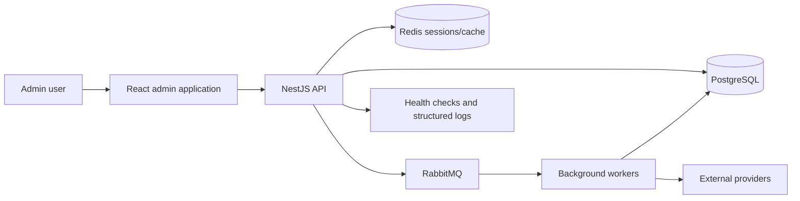

# TraceAxios Engineering Showcase

> A portfolio-safe engineering case study for a production-oriented SaaS platform that turns fragmented delivery activity into actionable team insights.

[Русская версия](README.ru.md)

[](https://www.typescriptlang.org/)
[](https://react.dev/)
[](https://nestjs.com/)
[](https://www.postgresql.org/)
[](https://www.rabbitmq.com/)
[](https://www.docker.com/)
[](https://github.com/RaysAndreyRU/traceaxios-showcase/actions/workflows/quality.yml)

## Why this repository exists

The complete TraceAxios product remains private to protect its business logic, integration contracts, deployment configuration, and production architecture. This repository provides enough evidence to review the engineering approach without publishing the product source.

It contains:

- a system-level architecture overview;
- the reasoning behind important design decisions;
- a compact, runnable TypeScript vertical slice;
- examples of boundary isolation, idempotency, and dependency inversion;
- the production testing and delivery strategy at a safe level of detail.

The code in `src/` is an original, simplified reference implementation. It is not copied from the production repository and contains no credentials, customer data, provider secrets, database schema, or proprietary algorithms.

## Product overview

TraceAxios is an engineering intelligence platform designed to unify activity from development and collaboration tools. It normalizes provider-specific events, maps them to teams and projects, and exposes operational signals through dashboards, reports, alerts, and AI-assisted analysis.

Representative integrations include GitHub, GitLab, Jira, Linear, Notion, Slack, Google Calendar, Calendly, and Figma.

## System architecture



The production system separates synchronous API work from provider synchronization and aggregation jobs. API instances can scale independently from worker processes, while repository and provider ports keep business rules isolated from Prisma, HTTP SDKs, and message transport.

Read the detailed [architecture case study](docs/architecture.md).

## Architecture deep dives

The following case studies were reconstructed from a focused review of the private backend implementation. They describe the engineering decisions and trade-offs without exposing production source, schemas, credentials, queue names, or proprietary scoring rules.

| Surface | Case study | Engineering focus |
| --- | --- | --- |
| Backend | [Split API and worker runtimes](docs/case-studies/01-split-api-worker-runtime.md) | Independent scaling, role-based NestJS composition, schedulers, processors, and graceful lifecycle boundaries. |
| Backend | [Multi-provider ingestion and project read models](docs/case-studies/02-provider-ingestion-and-read-models.md) | Provider registry, partial failure isolation, idempotent upserts, transactional materialization, and sync health. |
| Backend | [Revocable authentication and one-time flows](docs/case-studies/03-revocable-authentication.md) | JWT plus Redis sessions, refresh rotation, CSRF protection, atomic verification codes, and reset revocation. |
| Backend | [Hierarchical multi-tenant authorization](docs/case-studies/04-multi-tenant-authorization.md) | Organization, team, and project scopes; role invariants; ownership transfer; invitation transactions. |
| Backend | [Bounded AI analysis](docs/case-studies/05-bounded-ai-analysis.md) | Input minimization, structured-output normalization, deterministic fallbacks, permissions, and cached analysis. |
| Admin | [Enforceable Feature-Sliced Design](docs/case-studies/06-enforceable-fsd.md) | Machine-checked layer direction, public slice APIs, composition boundaries, and route-level code splitting. |
| Admin | [Resilient client data boundary](docs/case-studies/07-resilient-client-data-boundary.md) | Cookie authentication, CSRF, single-flight refresh, runtime contracts, and query-scope isolation. |
| Admin | [Deterministic frontend test platform](docs/case-studies/08-deterministic-frontend-testing.md) | Shared stateful MSW backend, fault injection, integration tests, Playwright, and independent browser coverage. |
| Landing | [SEO-first product surface](docs/case-studies/09-seo-first-landing.md) | SSG, international SEO, security headers, responsive theming, asset optimization, and executable SEO checks. |

Start with the [case study index](docs/case-studies/README.md) for a concise system map.

## Selected engineering decisions

| Concern | Approach | Reason |
| --- | --- | --- |
| Frontend boundaries | Feature-Sliced Design with enforced import direction | Keeps pages thin and prevents cross-feature coupling. |
| API design | Modular NestJS domains with explicit DTOs and repositories | Makes ownership and authorization boundaries visible. |
| Provider ingestion | Asynchronous RabbitMQ jobs with idempotent persistence | Keeps slow APIs away from request latency and supports safe retries. |
| Authentication | Short-lived JWTs backed by live Redis sessions | Allows immediate revocation instead of trusting token expiry alone. |
| Provider credentials | Encrypted at rest with controlled rotation | Reduces exposure of OAuth access and refresh tokens. |
| Quality gates | Independent unit/integration and browser coverage thresholds | Prevents one broad test layer from hiding gaps in another. |
| Delivery | Docker images gated by tests, type checks, and migration validation | Keeps deployable artifacts aligned with verified source. |

## Public vertical slice

The sample implements the application core of a provider activity synchronization flow:

```text
src/activity-sync/
├── application/
│   ├── sync-activities.types.ts
│   └── sync-activities.use-case.ts
├── domain/
│   ├── activity-normalizer.ts
│   └── activity.types.ts
└── ports/
    ├── activity-provider.port.ts
    └── activity-repository.port.ts
```

The use case demonstrates:

- dependency inversion through provider and repository ports;
- tenant-scoped input and persistence contracts;
- deterministic normalization of third-party events;
- duplicate suppression before persistence;
- rejection of invalid synchronization windows;
- explicit result metrics suitable for jobs and observability;
- behavior-focused tests with in-memory adapters.

The sample deliberately excludes production provider adapters, Prisma queries, queue topology, authorization rules, and aggregation formulas.

## Run the sample

Requirements: Node.js 22 and npm.

```bash
npm ci
npm run check
```

Available commands:

| Command | Purpose |
| --- | --- |
| `npm test` | Run behavior tests with Vitest. |
| `npm run test:coverage` | Run tests with coverage reporting. |
| `npm run typecheck` | Validate strict TypeScript contracts. |
| `npm run check` | Run the complete local quality gate. |

## Production quality strategy

The private product uses multiple independent quality layers:

- frontend unit and integration tests with Vitest, Testing Library, React Query, and MSW;
- browser journeys with Playwright against deterministic API mocks;
- backend service, controller, repository, provider, scheduler, and worker tests with Jest;
- PostgreSQL migration validation in CI;
- independent 80% thresholds for statements, branches, functions, and lines;
- Docker image builds only after their required quality gates succeed.

See [testing strategy](docs/testing.md) and [security model](docs/security.md).

## Repository map

```text
.
├── .github/workflows/quality.yml
├── docs/
│   ├── architecture.md
│   ├── case-studies/
│   ├── security.md
│   ├── testing.md
│   └── decisions/
├── src/activity-sync/
└── test/
```

## What reviewers can evaluate

- separation between domain, application, and infrastructure concerns;
- TypeScript API design and explicit contracts;
- handling of unreliable external systems;
- testability without network or database dependencies;
- system design reasoning and documented trade-offs;
- CI-oriented engineering discipline.

For a deeper technical review, I can provide a guided walkthrough of selected private modules during an interview.

## Author

**Andrey Rays** — Senior Fullstack Developer & Web3 Engineer

- GitHub: [@RaysAndreyRU](https://github.com/RaysAndreyRU)
- Telegram: [@RaysRU](https://t.me/RaysRU)
- Email: [raysandreyru@gmail.com](mailto:raysandreyru@gmail.com)

## Usage notice

This repository is published for portfolio review and technical evaluation. See [LICENSE](LICENSE) for usage restrictions.
