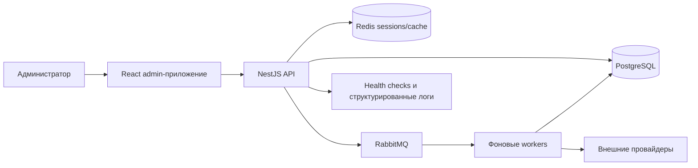

# TraceAxios — инженерная витрина

> Безопасный для публичного портфолио технический разбор production-ориентированной SaaS-платформы, которая превращает разрозненные данные о разработке в полезные сигналы о работе команд.

[English version](README.md)

[](https://www.typescriptlang.org/)
[](https://react.dev/)
[](https://nestjs.com/)
[](https://www.postgresql.org/)
[](https://www.rabbitmq.com/)
[](https://www.docker.com/)
[](https://github.com/RaysAndreyRU/traceaxios-showcase/actions/workflows/quality.yml)

## Зачем нужен этот репозиторий

Полный продукт TraceAxios остаётся приватным, чтобы защитить его бизнес-логику, интеграционные контракты, конфигурацию развёртывания и production-архитектуру. Этот репозиторий позволяет оценить инженерный подход, не публикуя исходный код продукта.

Здесь находятся:

- обзор системной архитектуры;
- обоснование важных архитектурных решений;
- компактный запускаемый vertical slice на TypeScript;
- примеры изоляции границ, идемпотентности и инверсии зависимостей;
- безопасное описание стратегии тестирования и доставки production-системы.

Код в `src/` — оригинальная упрощённая reference-реализация, написанная специально для витрины. Он не скопирован из production-репозитория и не содержит учётных данных, клиентской информации, секретов провайдеров, схемы базы данных или проприетарных алгоритмов.

## Обзор продукта

TraceAxios — платформа engineering intelligence, объединяющая активность из инструментов разработки и совместной работы. Она нормализует события разных провайдеров, связывает их с командами и проектами и формирует операционные сигналы для дашбордов, отчётов, уведомлений и AI-assisted анализа.

Среди представленных интеграций: GitHub, GitLab, Jira, Linear, Notion, Slack, Google Calendar, Calendly и Figma.

## Архитектура системы



Production-система отделяет синхронные API-запросы от синхронизации провайдеров и фоновых задач агрегации. API и workers могут масштабироваться независимо, а repository- и provider-порты изолируют бизнес-правила от Prisma, HTTP SDK и транспорта сообщений.

Подробности находятся в [разборе архитектуры](docs/architecture.md).

## Архитектурные разборы

Следующие case studies восстановлены после целевого анализа приватной реализации. Они описывают инженерные решения и компромиссы, не раскрывая production-код, схемы, учётные данные, названия очередей или проприетарные формулы оценки.

| Контур | Case study | Инженерный фокус |
| --- | --- | --- |
| Backend | [Разделение API и worker runtimes](docs/case-studies/01-split-api-worker-runtime.ru.md) ([EN](docs/case-studies/01-split-api-worker-runtime.md)) | Независимое масштабирование, ролевая композиция NestJS, schedulers, processors и управляемые границы жизненного цикла. |
| Backend | [Сбор данных из нескольких провайдеров и project read models](docs/case-studies/02-provider-ingestion-and-read-models.ru.md) ([EN](docs/case-studies/02-provider-ingestion-and-read-models.md)) | Реестр провайдеров, изоляция частичных сбоев, идемпотентные upsert-операции, транзакционная материализация и состояние синхронизации. |
| Backend | [Отзываемая аутентификация и одноразовые flows](docs/case-studies/03-revocable-authentication.ru.md) ([EN](docs/case-studies/03-revocable-authentication.md)) | JWT вместе с Redis-сессиями, ротация refresh-токенов, CSRF, атомарные verification codes и отзыв сессий после reset. |
| Backend | [Иерархическая multi-tenant авторизация](docs/case-studies/04-multi-tenant-authorization.ru.md) ([EN](docs/case-studies/04-multi-tenant-authorization.md)) | Области организации, команды и проекта; инварианты ролей; передача владения; транзакции приглашений. |
| Backend | [Ограниченный AI-анализ](docs/case-studies/05-bounded-ai-analysis.ru.md) ([EN](docs/case-studies/05-bounded-ai-analysis.md)) | Минимизация входных данных, нормализация structured output, детерминированные fallback-сценарии, permissions и кэширование. |
| Admin | [Контролируемая Feature-Sliced Design](docs/case-studies/06-enforceable-fsd.ru.md) ([EN](docs/case-studies/06-enforceable-fsd.md)) | Автоматическая проверка направления зависимостей, публичные API слайсов, границы композиции и route-level code splitting. |
| Admin | [Устойчивый клиентский data boundary](docs/case-studies/07-resilient-client-data-boundary.ru.md) ([EN](docs/case-studies/07-resilient-client-data-boundary.md)) | Cookie-аутентификация, CSRF, single-flight refresh, runtime-контракты и изоляция React Query cache scope. |
| Admin | [Детерминированная frontend test platform](docs/case-studies/08-deterministic-frontend-testing.ru.md) ([EN](docs/case-studies/08-deterministic-frontend-testing.md)) | Общий stateful MSW backend, fault injection, интеграционные тесты, Playwright и независимый контроль browser coverage. |
| Landing | [SEO-first продуктовая поверхность](docs/case-studies/09-seo-first-landing.ru.md) ([EN](docs/case-studies/09-seo-first-landing.md)) | SSG, международное SEO, security headers, адаптивная тема, оптимизация ресурсов и исполняемые SEO-проверки. |
| Эксплуатация | [Эволюция production-системы и дисциплина миграций](docs/case-studies/10-production-evolution-and-migrations.ru.md) ([EN](docs/case-studies/10-production-evolution-and-migrations.md)) | Expand–migrate–contract rollout, идемпотентные backfills, CI-проверка на чистой базе и recovery boundaries. |

Краткая карта системы находится в [индексе case studies](docs/case-studies/README.md).

## Выбранные инженерные решения

| Задача | Подход | Причина |
| --- | --- | --- |
| Границы frontend | Feature-Sliced Design с проверяемым направлением импортов | Страницы остаются тонкими, а зависимости между фичами не разрастаются. |
| API | Доменные NestJS-модули с явными DTO и repositories | Границы владения и авторизации остаются видимыми. |
| Сбор данных | Асинхронные RabbitMQ jobs с идемпотентным сохранением | Медленные provider API не влияют на request latency, а задачи можно безопасно повторять. |
| Аутентификация | Короткоживущие JWT, подтверждённые активными Redis-сессиями | Сессию можно немедленно отозвать, не ожидая истечения токена. |
| Credentials провайдеров | Шифрование при хранении и управляемая ротация | Снижается риск утечки OAuth access- и refresh-токенов. |
| Quality gates | Независимые пороги для unit/integration и browser coverage | Один широкий слой тестов не может скрыть пробелы в другом. |
| Delivery | Docker-образы создаются только после тестов, typecheck и проверки миграций | Развёртываемый артефакт соответствует проверенному исходному коду. |

## Публичный vertical slice

Пример реализует application core процесса синхронизации активности провайдера:

```text
src/activity-sync/
├── application/
│   ├── sync-activities.types.ts
│   └── sync-activities.use-case.ts
├── domain/
│   ├── activity-normalizer.ts
│   └── activity.types.ts
└── ports/
    ├── activity-provider.port.ts
    └── activity-repository.port.ts
```

Use case демонстрирует:

- инверсию зависимостей через provider- и repository-порты;
- tenant-scoped контракты входных данных и сохранения;
- детерминированную нормализацию событий внешних систем;
- удаление дубликатов перед сохранением;
- отклонение некорректных окон синхронизации;
- явные метрики результата для jobs и observability;
- поведенческие тесты с in-memory адаптерами.

В пример намеренно не включены production-адаптеры провайдеров, Prisma-запросы, топология очередей, правила авторизации и формулы агрегации.

## Запуск примера

Требования: Node.js 22 и npm.

```bash
npm ci
npm run check
```

Доступные команды:

| Команда | Назначение |
| --- | --- |
| `npm test` | Запустить поведенческие тесты через Vitest. |
| `npm run test:coverage` | Запустить тесты с отчётом о покрытии. |
| `npm run typecheck` | Проверить строгие TypeScript-контракты. |
| `npm run check` | Запустить полный локальный quality gate. |

## Стратегия качества production-системы

В приватном продукте используется несколько независимых уровней контроля:

- frontend unit- и integration-тесты на Vitest, Testing Library, React Query и MSW;
- browser-сценарии в Playwright с детерминированными API-моками;
- backend-тесты сервисов, контроллеров, repositories, providers, schedulers и workers на Jest;
- проверка PostgreSQL-миграций в CI;
- независимые пороги 80% для statements, branches, functions и lines;
- сборка Docker-образов только после успешного прохождения обязательных quality gates.

Подробнее: [стратегия тестирования](docs/testing.md) и [модель безопасности](docs/security.md).

## Карта репозитория

```text
.
├── .github/workflows/quality.yml
├── docs/
│   ├── architecture.md
│   ├── case-studies/
│   ├── security.md
│   ├── testing.md
│   └── decisions/
├── src/activity-sync/
└── test/
```

## Что могут оценить технические специалисты

- разделение domain-, application- и infrastructure-ответственности;
- дизайн TypeScript API и явные контракты;
- обработку ненадёжных внешних систем;
- тестируемость без сетевых и database-зависимостей;
- аргументацию системных решений и документированные компромиссы;
- инженерную дисциплину, ориентированную на CI.

На техническом интервью я могу провести подробный walkthrough выбранных приватных модулей.

## Автор

**Andrey Rays** — Fullstack TypeScript Engineer · Web3 Engineer

- GitHub: [@RaysAndreyRU](https://github.com/RaysAndreyRU)
- Telegram: [@RaysRU](https://t.me/RaysRU)
- Email: [raysandreyru@gmail.com](mailto:raysandreyru@gmail.com)

## Условия использования

Репозиторий опубликован для просмотра портфолио и технической оценки. Ограничения использования описаны в [LICENSE](LICENSE).
