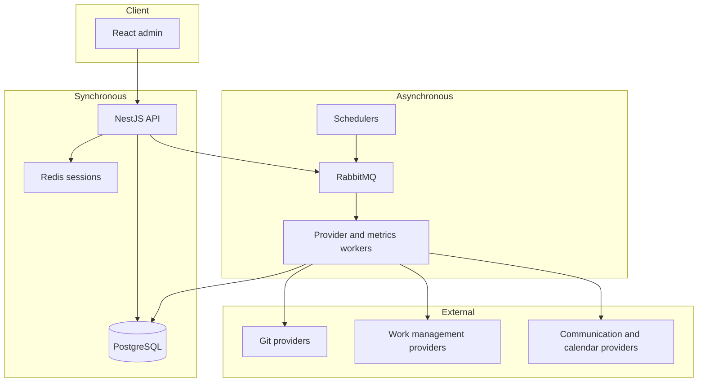
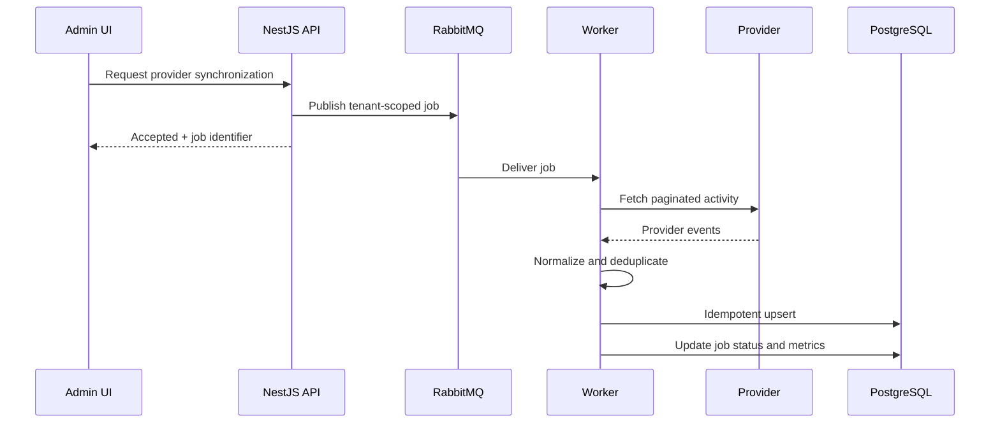

# Architecture Case Study

## Context

Engineering activity arrives from systems with different authentication models, pagination rules, schemas, rate limits, and consistency guarantees. TraceAxios must accept user-facing requests quickly while continuing potentially slow provider synchronization in the background.

The platform also operates across organizations, teams, and projects. Tenant isolation and authorization therefore belong to every application boundary rather than being treated as controller-only concerns.

## Runtime view



## Request boundary

A protected request follows an explicit chain:

1. JWT signature and claims are validated.
2. The access session is checked in Redis to support immediate revocation.
3. Tenant membership and role requirements are evaluated.
4. The controller binds the transport contract.
5. An application service executes the scenario.
6. Repositories isolate Prisma and persistence decisions.
7. Response DTOs prevent accidental leakage of internal models.

## Provider synchronization



External IDs and tenant/provider identity form the basis of idempotent writes. Retryable failures are distinguished from terminal validation and authorization failures. Provider adapters own vendor-specific pagination and mapping; the application layer depends only on ports.

## Frontend composition

The admin application follows Feature-Sliced Design:

```text
app -> pages -> widgets -> features -> entities -> shared
```

Dependencies point downward. Slices at the same layer do not import each other directly. When one large screen contains several sections, those sections are composed below a page boundary or extracted into segment-local components instead of creating cyclic widget dependencies.

React Query owns server state and cache invalidation. Zustand is reserved for client-side state that is not naturally represented by the URL or server cache. API transport, error normalization, and authentication recovery live in shared infrastructure.

## Deliberately omitted

This public description does not include the production database schema, queue routing keys, provider scopes, scoring formulas, organization permission matrix, deployment manifests, or internal module map.
