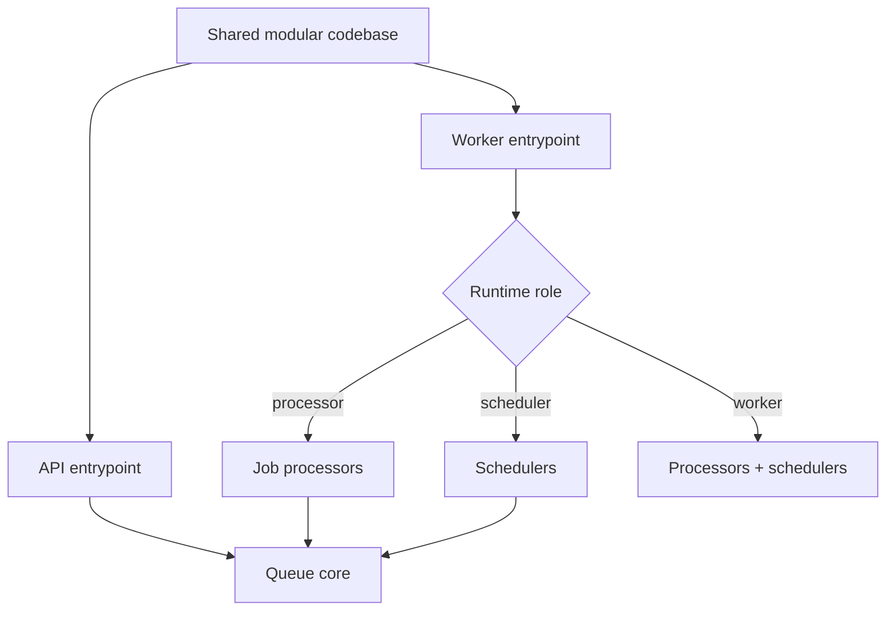

# Case Study: Split API and Worker Runtimes

## Problem

Provider synchronization, metric snapshots, and token maintenance can be slow or bursty. Running them in the HTTP request lifecycle would couple user-facing latency to external APIs and make horizontal scaling inefficient.

At the same time, maintaining entirely separate services for every job type would add deployment and operational cost before the workload justified it.

## Decision

TraceAxios uses one modular NestJS codebase with separate API and worker entrypoints. Runtime composition is controlled by a job role:

- API processes load queue publishing but no schedulers or consumers;
- processor processes consume provider, metrics, and token jobs;
- scheduler processes publish repeatable orchestration jobs;
- a combined worker role can run processors and schedulers together in smaller environments.

## Implementation characteristics

- The worker entrypoint loads configuration, Prisma, structured logging, and job modules without HTTP controllers.
- Job infrastructure is separated into core, processor, and scheduler NestJS modules.
- API instances can enqueue work without accidentally starting consumers.
- Job types have explicit payload and result contracts.
- Daily fan-out uses deterministic job identities, configurable batching, staggering, retry count, and backoff.
- Lifecycle hooks close RabbitMQ channels and connections during shutdown.

## Why this shape

This is a pragmatic middle ground between a single all-in-one process and independently versioned microservices. Domain modules stay in one repository, while runtime workloads scale separately in Docker or Kubernetes.

The design preserves a migration path: a processor can later become its own service without first rewriting the domain boundary.

## Trade-offs identified during review

The current queue status view is process-local, and delayed retries are scheduled in application memory. Durable RabbitMQ queues and persistent messages protect brokered work, but process-local delay timers do not provide the same guarantee.

For a larger production footprint, the next hardening steps would be:

- persist job status in Redis or PostgreSQL;
- move delayed retries to a delayed exchange, TTL queue, or dead-letter topology;
- add a dead-letter queue and operational replay tooling;
- use publisher confirms for stronger publish guarantees;
- coordinate scheduler leadership when multiple scheduler replicas are running.

Publishing these limitations is deliberate: the architecture is suitable for its current stage, while the scaling boundary is clearly understood.

## Engineering signal

This case demonstrates workload decomposition, dependency-aware module composition, asynchronous orchestration, and the ability to evolve a modular monolith toward independently scalable services.
