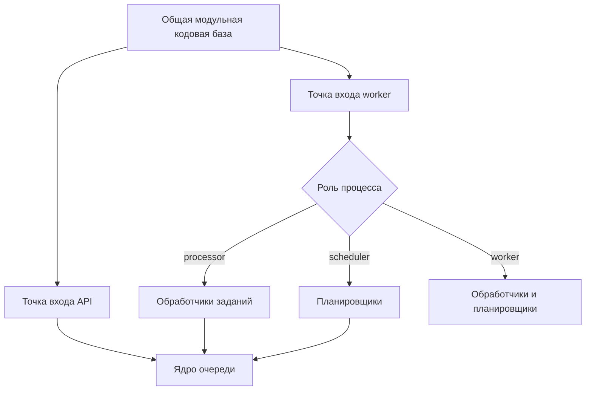

# Кейс: разделение API и worker-процессов

[English](01-split-api-worker-runtime.md) | [Русский]

## Проблема

Синхронизация провайдеров, снимки метрик и обслуживание токенов могут выполняться долго и создавать пиковую нагрузку. Если запускать их внутри HTTP-запроса, задержки внешних API напрямую влияют на пользователя, а горизонтальное масштабирование становится неэффективным.

При этом отдельный сервис для каждого типа фоновой задачи преждевременно увеличил бы стоимость развёртывания и эксплуатации.

## Решение

TraceAxios использует одну модульную кодовую базу NestJS с отдельными точками входа для API и workers. Состав runtime определяется ролью процесса:

- API публикует задания, но не запускает schedulers и consumers;
- processor обрабатывает задания провайдеров, метрик и токенов;
- scheduler публикует повторяемые orchestration jobs;
- совмещённая роль worker запускает processors и schedulers вместе в небольших окружениях.

## Особенности реализации

- Worker загружает конфигурацию, Prisma, структурированные логи и job-модули без HTTP-контроллеров.
- Инфраструктура заданий разделена на core-, processor- и scheduler-модули NestJS.
- API может ставить задачи в очередь, не запуская consumers случайно.
- Payload и результат каждого типа задания имеют явные контракты.
- Ежедневный fan-out использует детерминированные ID, настраиваемые batch size, задержки, число повторов и backoff.
- Lifecycle hooks закрывают RabbitMQ channels и connections при остановке.

## Почему выбрана такая форма

Это практичный баланс между единым процессом и независимо версионируемыми микросервисами. Доменные модули остаются в одном репозитории, но API и фоновые нагрузки масштабируются отдельно в Docker или Kubernetes.

При необходимости отдельный processor можно вынести в самостоятельный сервис без предварительной переработки доменной границы.

## Компромиссы и дальнейшее усиление

Текущее представление статуса очереди локально для процесса, а отложенные повторы планируются в памяти приложения. Durable queues и persistent messages защищают уже переданную брокеру работу, но локальные таймеры не дают такой же гарантии.

Для более крупного production-контура потребуются:

- хранение статуса заданий в Redis или PostgreSQL;
- перенос задержанных повторов в delayed exchange, TTL queue или dead-letter topology;
- dead-letter queue и инструменты повторного запуска;
- publisher confirms для более строгой гарантии публикации;
- координация лидерства scheduler при нескольких репликах.

Ограничения описаны явно: архитектура соответствует текущему масштабу, а граница дальнейшего роста понятна заранее.

## Инженерный результат

Кейс показывает декомпозицию нагрузки, композицию модулей с учётом зависимостей, асинхронную оркестрацию и эволюцию модульного монолита к независимо масштабируемым сервисам.
