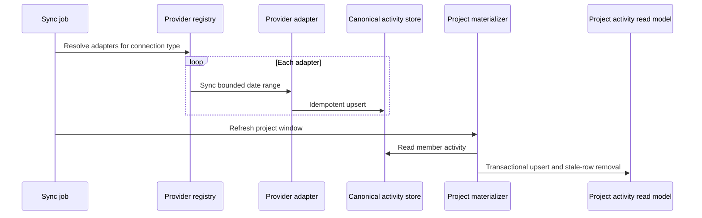

# Case Study: Multi-Provider Ingestion and Project Read Models

## Problem

Engineering activity comes from providers with incompatible schemas and behavior. A single user connection may produce multiple activity streams; for example, one workspace integration can yield calendar, document, and meeting events.

The product also needs project-scoped dashboards. Recomputing project membership and searching raw provider payloads for every dashboard request would make reads expensive and difficult to reason about.

## Decision

The ingestion design separates connection discovery, provider-specific adapters, normalized activity storage, and project-scoped materialization.

## Implementation characteristics

### Provider registry

A registry maps each connection type to one or more activity adapters. The application service depends on a small provider interface rather than importing vendor SDKs directly.

This makes a provider addition a bounded change:

1. implement the adapter contract;
2. register it with a connection type;
3. add normalization and boundary tests;
4. keep the orchestration service unchanged.

### Failure isolation

Each adapter is synchronized independently. A failure is recorded for that connection and provider while other configured providers continue. Connection metadata records the last attempt, status, and error summary, allowing the UI to expose integration health instead of reducing a partial failure to a generic 500 response.

### Idempotent canonical store

Normalized activity uses a stable uniqueness boundary based on user, provider, and external event identity. Provider retries update an existing activity rather than inflating metrics with duplicates.

### Project read model

Project dashboards consume a materialized project-activity table rather than repeatedly deriving project scope during every request. Refreshes run inside a database transaction:

- matching source activity is upserted;
- changed source data updates the materialized row;
- rows no longer present inside the refreshed window are deleted;
- project/provider/time indexes support dashboard access patterns.

This is a deliberately small CQRS-style optimization: the canonical activity table remains the source of truth, while the project table is a disposable read model.

## Alternatives considered

### Query raw provider payloads on every request

This avoids a materialized table but spreads provider-specific matching across dashboard queries and increases read cost. It was rejected for the project view.

### Store every provider in a completely separate pipeline

This offers strong isolation but duplicates scheduling, health tracking, authorization, and persistence behavior. The shared port-and-registry model gives sufficient isolation with lower operational overhead.

### Stop the whole synchronization on the first provider error

This is simpler but hides usable results from healthy providers. Partial completion with explicit health metadata is more useful operationally.

## Trade-offs and next steps

- Materialized views are eventually consistent with canonical activity.
- Provider identity quality determines idempotency quality.
- Project classification currently relies on known source mappings and defensive matching; richer provider-native project identifiers would reduce ambiguity.
- Large refresh windows should move from row-by-row upserts toward batch operations where measurement justifies it.
- Reconciliation metrics should compare canonical and materialized counts to detect drift.

## Engineering signal

This case demonstrates anti-corruption layers around external APIs, idempotent ingestion, partial failure handling, transactional read-model maintenance, and practical CQRS without unnecessary platform complexity.
