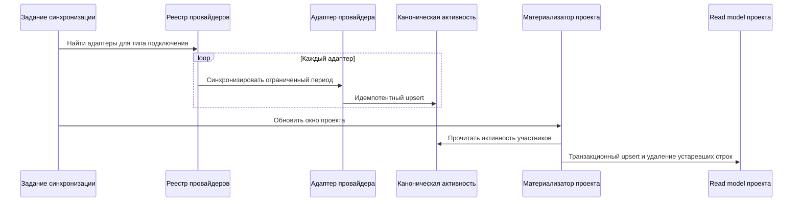

# Кейс: сбор данных из нескольких провайдеров и project read models

[English](02-provider-ingestion-and-read-models.md) | [Русский]

## Проблема

Инженерная активность поступает от провайдеров с несовместимыми схемами и поведением. Одно подключение пользователя может создавать несколько потоков событий: например, интеграция workspace даёт события календаря, документов и встреч.

Продукту также нужны project-scoped dashboards. Если при каждом запросе вычислять участников проекта и искать по сырым payload провайдеров, чтение станет дорогим и сложным для анализа.

## Решение

Контур ingestion разделяет обнаружение подключений, provider-specific adapters, нормализованное хранилище активности и материализацию в рамках проекта.

## Особенности реализации

### Реестр провайдеров

Реестр связывает тип подключения с одним или несколькими адаптерами активности. Application service зависит от небольшого provider interface, а не от SDK поставщика напрямую.

Добавление провайдера остаётся ограниченным изменением:

1. реализовать контракт адаптера;
2. зарегистрировать его для типа подключения;
3. добавить тесты нормализации и границ;
4. не менять orchestration service.

### Изоляция сбоев

Каждый адаптер синхронизируется независимо. Ошибка фиксируется для конкретного подключения и провайдера, а остальные продолжают работу. Метаданные подключения содержат время последней попытки, статус и краткое описание ошибки, поэтому UI показывает состояние интеграции вместо безликой ошибки 500.

### Идемпотентное каноническое хранилище

Уникальность нормализованной активности основана на пользователе, провайдере и внешнем ID события. Повтор провайдера обновляет существующую запись, а не раздувает метрики дубликатами.

### Project read model

Дашборды читают материализованную таблицу активности проекта, а не пересчитывают scope при каждом запросе. Обновление выполняется в транзакции:

- совпадающая исходная активность создаётся или обновляется;
- изменённые данные обновляют материализованную строку;
- отсутствующие в новом окне строки удаляются;
- индексы по проекту, провайдеру и времени поддерживают типовые чтения.

Это компактная CQRS-оптимизация: каноническая таблица остаётся источником истины, а project table — восстанавливаемой read model.

## Рассмотренные альтернативы

Запрос сырых payload при каждом чтении разносит provider-specific логику по dashboard queries и повышает стоимость. Полностью отдельные pipelines усиливают изоляцию, но дублируют планирование, health tracking, авторизацию и хранение. Остановка всей синхронизации при первой ошибке скрывает полезные результаты исправных провайдеров.

## Компромиссы и следующие шаги

- Read models согласуются с канонической активностью eventual-consistently.
- Качество идемпотентности зависит от качества внешней идентичности.
- Более точные provider-native project IDs уменьшат неоднозначность классификации.
- Большие окна стоит переводить с построчных upsert на batch operations после измерений.
- Reconciliation metrics должны выявлять расхождения между каноническими и материализованными данными.

## Инженерный результат

Кейс демонстрирует anti-corruption layers для внешних API, идемпотентный ingestion, частичные сбои, транзакционное обслуживание read models и практичный CQRS без лишней платформенной сложности.
