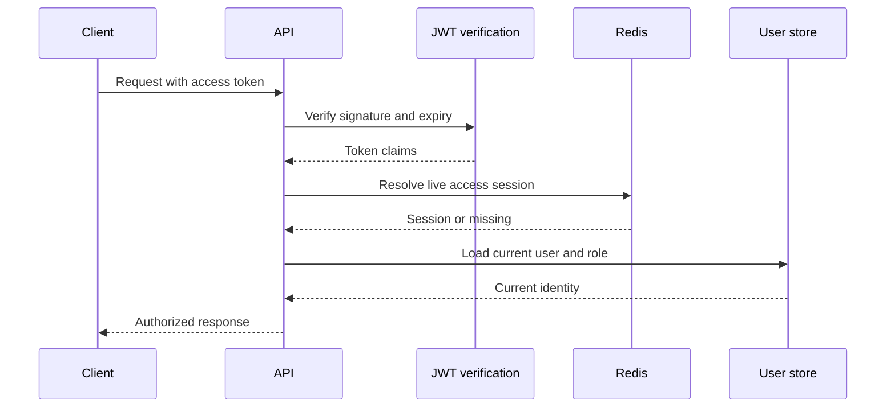

# Case Study: Revocable Authentication and One-Time Flows

## Problem

Signed JWTs are convenient for distributed APIs, but a valid self-contained token cannot normally be revoked before it expires. The platform also needs login confirmation, email verification, password reset, refresh rotation, logout-all, and browser CSRF protection.

These flows become vulnerable to replay and race conditions when verification and deletion are implemented as separate cache operations.

## Decision

TraceAxios combines short-lived JWTs with Redis-backed session state. Cryptographic validation proves that a token was issued by the platform; the Redis lookup proves that the session is still active.

## Session model

- Access and refresh tokens are indexed to a shared session record in Redis.
- Access and refresh indexes have independent TTLs.
- Every protected request checks the access token against the live session.
- Logout removes the session and both indexes immediately.
- Logout-all scans and invalidates every session belonging to the user.
- Refresh verifies both the JWT and its Redis session, issues a new pair, and invalidates the old refresh session.
- Password reset invalidates all existing sessions and outstanding login-code sessions.

The result preserves JWT portability while retaining server-side revocation.

## Atomic one-time-code verification

Login and email-confirmation codes are stored as session-bound hashes, not plaintext values. A Redis Lua script performs verification as one atomic operation:

1. read the verification session and expected hash;
2. increment the attempt counter on a mismatch;
3. preserve the counter TTL;
4. delete the entire verification state after the configured attempt limit;
5. delete and return the session on success.

Two concurrent confirmations therefore cannot both consume the same code successfully. Resend cooldown keys provide a second control against mail abuse and brute-force attempts.

Password-reset and legacy email-confirmation tokens use atomic get-and-delete semantics for the same replay-resistance goal.

## Browser controls

- Authentication supports secure cookie transport and explicit bearer tokens.
- Unsafe HTTP methods require a CSRF header matching the CSRF cookie.
- Access tokens are short-lived; refresh tokens use a separate secret and longer TTL.
- Current user and current role are loaded after session validation, preventing stale JWT role claims from becoming the final authorization source.

## Threat-to-control map

| Threat | Control |
| --- | --- |
| Stolen but not yet expired access token | Redis session revocation and short access TTL. |
| Refresh-token replay | Live refresh-session lookup and rotation. |
| Concurrent one-time-code reuse | Atomic Lua verification and deletion. |
| Verification brute force | Attempt limit, TTL, and resend cooldown. |
| Password-reset replay | Hashed token with atomic consumption. |
| Browser cross-site request forgery | Cookie/header CSRF comparison on unsafe methods. |
| Role changed after token issuance | Current user and role loaded during request validation. |

## Trade-offs and next steps

- Every protected request depends on Redis availability.
- Session keys currently contain token material; hashing index keys would reduce exposure in cache diagnostics.
- Refresh rotation should be monitored for reuse attempts and suspicious concurrency.
- High-scale logout-all requires careful SCAN sizing and observability.
- Key rotation needs an operational migration plan because it affects active tokens and sessions.

## Engineering signal

This case demonstrates security as state-machine design: revocation, replay resistance, atomicity, bounded attempts, and explicit failure behavior rather than authentication as a single JWT library call.
