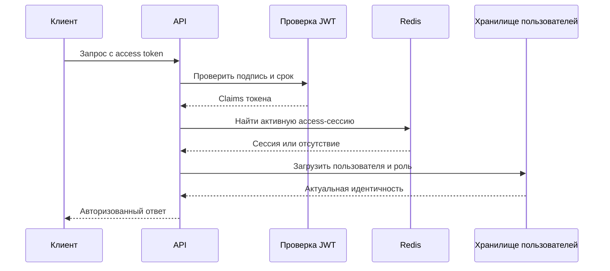

# Кейс: отзываемая аутентификация и одноразовые сценарии

[English](03-revocable-authentication.md) | [Русский]

## Проблема

Подписанные JWT удобны для распределённых API, но валидный автономный токен обычно нельзя отозвать до истечения срока. Платформе также нужны подтверждение входа и email, сброс пароля, ротация refresh-токенов, logout-all и защита браузера от CSRF.

Если проверка и удаление одноразового кода выполняются разными cache-операциями, возникают replay-атаки и race conditions.

## Решение

TraceAxios сочетает короткоживущие JWT с состоянием сессий в Redis. Криптографическая проверка подтверждает выпуск токена платформой, а Redis — что сессия всё ещё активна.

## Модель сессии

- Access и refresh tokens индексируются на общую запись сессии в Redis.
- Для индексов используются независимые TTL.
- Каждый защищённый запрос проверяет access token по живой сессии.
- Logout немедленно удаляет сессию и оба индекса.
- Logout-all находит и инвалидирует все сессии пользователя.
- Refresh проверяет JWT и Redis-сессию, выдаёт новую пару и инвалидирует старую refresh-сессию.
- Сброс пароля отзывает все сессии и незавершённые login-code flows.

Так сохраняется переносимость JWT и появляется серверный отзыв.

## Атомарная проверка одноразового кода

Коды входа и подтверждения email хранятся как привязанные к сессии хэши. Redis Lua script атомарно:

1. читает сессию проверки и ожидаемый хэш;
2. увеличивает счётчик при несовпадении;
3. сохраняет TTL счётчика;
4. удаляет всё состояние после лимита попыток;
5. при успехе удаляет и возвращает сессию.

Два параллельных подтверждения не могут успешно использовать один код. Отдельные cooldown keys ограничивают злоупотребление отправкой писем и brute force. Reset-токены используют атомарный get-and-delete для той же защиты от повторного применения.

## Защита браузера

- Поддерживаются secure cookies и явные bearer tokens.
- Небезопасные HTTP-методы требуют CSRF header, совпадающий с CSRF cookie.
- Access token короткоживущий; refresh token имеет отдельный secret и более длинный TTL.
- Пользователь и роль загружаются после проверки сессии, поэтому устаревший role claim не становится окончательным источником авторизации.

## Соответствие угроз и мер защиты

| Угроза | Мера защиты |
| --- | --- |
| Украденный, но ещё действующий access token | Отзыв Redis-сессии и короткий TTL. |
| Повторное использование refresh token | Проверка живой сессии и ротация. |
| Параллельное применение одноразового кода | Атомарная Lua-проверка и удаление. |
| Перебор кода | Лимит попыток, TTL и cooldown повторной отправки. |
| Повтор reset token | Хэшированный токен с атомарным потреблением. |
| CSRF в браузере | Сравнение cookie и header для небезопасных методов. |
| Роль изменилась после выпуска токена | Загрузка актуальных пользователя и роли на запросе. |

## Компромиссы и следующие шаги

- Каждый защищённый запрос зависит от доступности Redis.
- Хэширование индексных ключей снизит раскрытие token material в cache diagnostics.
- Нужно отслеживать повторное использование refresh token и подозрительную конкуренцию.
- Logout-all в большом масштабе требует настройки SCAN и наблюдаемости.
- Для key rotation нужен план миграции активных токенов и сессий.

## Инженерный результат

Кейс показывает безопасность как проектирование state machine: отзыв, replay resistance, атомарность, ограниченные попытки и явное поведение при ошибках вместо одной настройки JWT-библиотеки.
