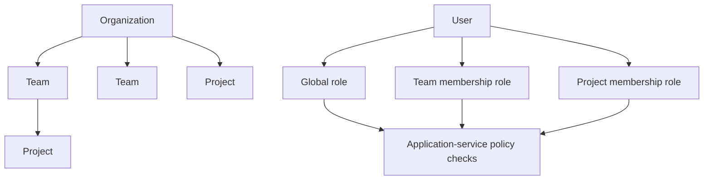
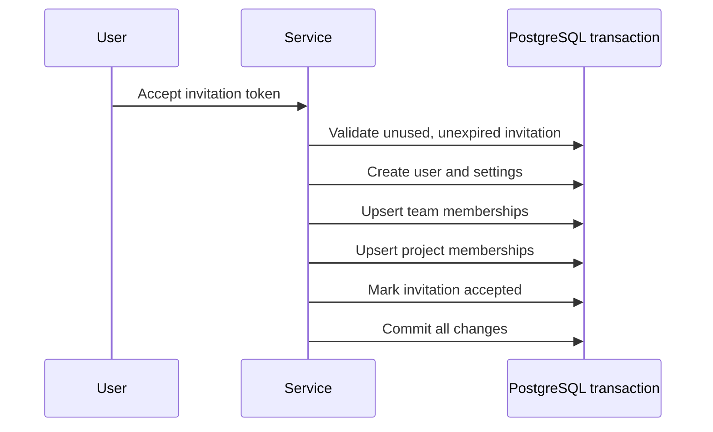

# Case Study: Hierarchical Multi-Tenant Authorization

## Problem

TraceAxios data belongs to organizations, teams, projects, and individual users. A global role alone is not enough: someone can administer one team, contribute to a project, and have no access to another project in the same organization.

Membership changes also need invariants. Removing or demoting the last owner would leave a scope without an accountable administrator.

## Decision

Authorization combines global user roles with resource-scoped membership roles:

Application services evaluate access before repository operations. Repository methods always receive the relevant organization, team, project, or user boundary instead of relying on an unrestricted entity lookup followed by UI filtering.

## Policy examples

- Organization owners and authorized team administrators can modify shared resources.
- Team reads require organization-level authority or membership in that team.
- Project reads require organization/team authority or direct project membership.
- Project member management requires a project owner or maintainer unless organization policy grants broader control.
- Team and project owner roles cannot be removed or demoted when they are the final owner.
- Ownership transfer requires the current owner and promotes the selected replacement as one operation.

These rules are business invariants, not only controller decorators, so they remain active when the same service is called by another transport or background workflow.

## Transactional invitation acceptance

An invitation can carry several effects: user creation, default settings, team roles, project roles, contributor linkage, onboarding state, and invitation consumption.

Acceptance executes in a PostgreSQL transaction:

If any membership assignment fails, the user is not left in a partially provisioned state.

## Alternatives considered

### Global RBAC only

Easy to implement, but too coarse for project and team boundaries. It cannot express a maintainer in one project and a viewer in another.

### Controller-only guards

Useful for broad authentication and role checks, but insufficient for resource ownership and membership rules that require database context.

### Full policy engine from the start

A dedicated policy framework could centralize rules, but it would add abstraction before the policy surface stabilizes. Explicit application-service checks currently keep behavior reviewable.

## Trade-offs and next steps

- Explicit checks can become repetitive as the permission matrix grows.
- A typed policy layer is the natural next step when several modules repeat the same organization/team/project decision.
- Authorization tests must cover cross-tenant identifiers, not only missing roles.
- Database constraints and transactions should continue to backstop application-level owner invariants under concurrency.

## Engineering signal

This case demonstrates defense-in-depth tenant isolation, contextual RBAC, transactional provisioning, and preservation of ownership invariants across nested resources.
