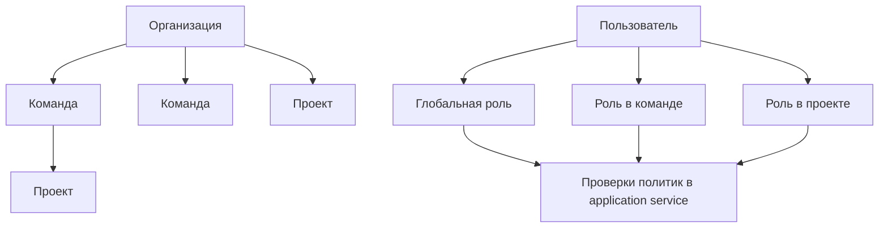
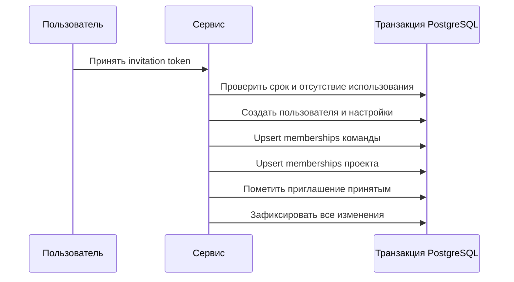

# Кейс: иерархическая multi-tenant авторизация

[English](04-multi-tenant-authorization.md) | [Русский]

## Проблема

Данные TraceAxios принадлежат организациям, командам, проектам и отдельным пользователям. Одной глобальной роли недостаточно: человек может администрировать одну команду, участвовать в проекте и не иметь доступа к другому проекту той же организации.

Изменения состава также должны соблюдать инварианты. Удаление или понижение последнего владельца оставило бы scope без ответственного администратора.

## Решение

Авторизация объединяет глобальные роли и роли участника в конкретном ресурсе:

Application services проверяют доступ до вызова repository. Методы repository всегда получают границу организации, команды, проекта или пользователя, а не выполняют неограниченный поиск с последующей фильтрацией в UI.

## Примеры политик

- Владельцы организации и уполномоченные администраторы команды изменяют общие ресурсы.
- Чтение команды требует полномочий организации или членства в команде.
- Чтение проекта требует полномочий организации/команды либо прямого членства.
- Участниками проекта управляет owner или maintainer, если политика организации не даёт более широких прав.
- Последнего owner команды или проекта нельзя удалить или понизить.
- Передача владения требует текущего owner и повышает выбранную замену в одной операции.

Это бизнес-инварианты, а не только controller decorators, поэтому они действуют и при вызове сервиса другим transport или background workflow.

## Транзакционное принятие приглашения

Приглашение может одновременно создавать пользователя и настройки, назначать роли, связывать contributor, менять onboarding state и помечать приглашение использованным.

При сбое назначения любой роли пользователь не остаётся частично подготовленным.

## Рассмотренные альтернативы

Глобальный RBAC слишком груб для проектных и командных границ. Controller-only guards не выражают правила владения и membership, которым нужен контекст БД. Полноценный policy engine централизовал бы правила, но добавил бы абстракцию до стабилизации policy surface; явные application-service checks пока проще проверять.

## Компромиссы и следующие шаги

- С ростом permission matrix явные проверки могут повторяться.
- Когда несколько модулей повторят одно решение organization/team/project, естественным шагом станет typed policy layer.
- Тесты авторизации должны покрывать cross-tenant identifiers, а не только отсутствие роли.
- Database constraints и transactions должны защищать owner invariants при конкуренции.

## Инженерный результат

Кейс демонстрирует многоуровневую tenant isolation, contextual RBAC, транзакционную подготовку пользователей и сохранение инвариантов владения во вложенных ресурсах.
