# Case Study: Bounded AI Analysis

## Problem

AI-assisted summaries can make multi-provider activity easier to interpret, but raw provider events are large, inconsistent, and sometimes sensitive. Model output is also probabilistic: it may return invalid JSON, different key casing, missing fields, or incomplete sections.

A production API cannot pass those uncertainties directly to the frontend.

## Decision

The AI layer is treated as an untrusted external adapter behind deterministic application rules.

```mermaid
flowchart LR
    Activity[Normalized activity] --> Minimize[Remove metadata and bound input]
    Minimize --> Model[AI provider]
    Model --> Parse[Defensive JSON extraction]
    Parse --> Normalize[Key and enum normalization]
    Normalize --> Validate[DTO-compatible response]
    Validate --> Fallback[Deterministic missing-section fallback]
    Fallback --> Cache[(Analysis snapshot)]
    Cache --> API[Stable API response]
```

## Input boundary

- Activity is first mapped into a provider-neutral event contract.
- Provider metadata is removed before model invocation.
- The serialized payload is capped; optional detail is removed before event count is reduced.
- User-level AI analysis respects the user's feature setting.
- Team analysis requires a managerial role.
- Date ranges are validated before querying activity or calling the model.

This reduces token cost and disclosure surface while keeping the analytical input predictable.

## Output boundary

The model is instructed to return a defined JSON shape, but the application still assumes the response may be malformed.

The normalization pipeline:

1. rejects empty responses;
2. attempts direct JSON parsing;
3. tolerates a fenced or embedded JSON object;
4. requires an object rather than arbitrary text or arrays;
5. normalizes inconsistent key casing;
6. constrains numeric and enum-like values;
7. reconstructs required sections from deterministic activity summaries when needed.

The API therefore exposes its own contract rather than the model's raw response.

## Snapshot and cache behavior

Completed analyses are stored against user and period. Repeated requests can reuse a compatible snapshot instead of paying model latency and cost again. Team aggregation computes deterministic fallback totals from member summaries before asking the model for higher-level interpretation.

## Failure philosophy

The AI provider enriches the product; it is not the source of truth for activity. Canonical provider events and calculated metrics remain available when AI output is unavailable or incomplete.

This distinction prevents model instability from corrupting operational data.

## Trade-offs and next steps

- Aggressive payload bounds can remove useful context and should be measured against analysis quality.
- Cache invalidation needs a clear policy when source activity changes inside an analyzed period.
- Structured model output or schema-constrained decoding can replace some defensive parsing as provider support matures.
- Prompts and normalization rules require regression fixtures because model upgrades can change output shape.
- Sensitive-field classification should remain explicit as new providers are added.

## Engineering signal

This case demonstrates privacy-aware input minimization, anti-corruption boundaries around probabilistic systems, deterministic fallback behavior, cost-aware caching, and role-aware AI features.
