# Кейс: ограниченный и контролируемый AI-анализ

[English](05-bounded-ai-analysis.md) | [Русский]

## Проблема

AI-сводки упрощают понимание активности из разных провайдеров, но сырые события велики, неоднородны и могут содержать чувствительные данные. Ответ модели вероятностный: возможны невалидный JSON, другой регистр ключей, пропущенные поля или неполные разделы.

Production API не может передавать эту неопределённость напрямую frontend.

## Решение

AI-слой рассматривается как недоверенный внешний адаптер за детерминированными правилами приложения.

```mermaid
flowchart LR
    Activity[Нормализованная активность] --> Minimize[Удаление metadata и ограничение input]
    Minimize --> Model[AI-провайдер]
    Model --> Parse[Защитное извлечение JSON]
    Parse --> Normalize[Нормализация ключей и enum]
    Normalize --> Validate[Ответ по контракту DTO]
    Validate --> Fallback[Детерминированное заполнение пропусков]
    Fallback --> Cache[(Снимок анализа)]
    Cache --> API[Стабильный API-ответ]
```

## Граница входных данных

- Активность преобразуется в provider-neutral event contract.
- Provider metadata удаляется до вызова модели.
- Размер сериализованного payload ограничен; сначала убираются необязательные детали, затем сокращается число событий.
- Пользовательский AI-анализ учитывает feature setting пользователя.
- Командный анализ требует managerial role.
- Диапазон дат проверяется до чтения активности и вызова модели.

Это снижает стоимость токенов и поверхность раскрытия, сохраняя предсказуемый input.

## Граница выходных данных

Модель получает инструкцию вернуть заданную JSON-структуру, но приложение всё равно предполагает возможную ошибку. Pipeline нормализации:

1. отклоняет пустой ответ;
2. пытается разобрать JSON напрямую;
3. допускает JSON в code fence или внутри текста;
4. требует объект, а не произвольный текст или массив;
5. нормализует регистр ключей;
6. ограничивает числовые и enum-like значения;
7. восстанавливает обязательные разделы из детерминированных сводок активности.

API публикует собственный контракт, а не сырой ответ модели.

## Снимки и кэш

Готовые анализы хранятся по пользователю и периоду. Повторный запрос переиспользует совместимый snapshot вместо новой задержки и стоимости модели. Для командной агрегации сначала рассчитываются детерминированные totals, а модель добавляет интерпретацию верхнего уровня.

## Поведение при сбое

AI обогащает продукт, но не является источником истины. Канонические события и рассчитанные метрики доступны даже при недоступном или неполном AI-ответе, поэтому нестабильность модели не повреждает операционные данные.

## Компромиссы и следующие шаги

- Жёсткие лимиты payload могут убрать полезный контекст; влияние нужно измерять.
- Нужна политика cache invalidation при изменении активности внутри периода.
- Schema-constrained decoding со временем упростит защитный parsing.
- Prompts и normalization rules требуют regression fixtures при обновлении моделей.
- Классификация чувствительных полей должна быть явной для каждого нового провайдера.

## Инженерный результат

Кейс показывает privacy-aware минимизацию входа, anti-corruption boundary вокруг вероятностной системы, детерминированные fallbacks, cost-aware caching и ролевой доступ к AI-функциям.
