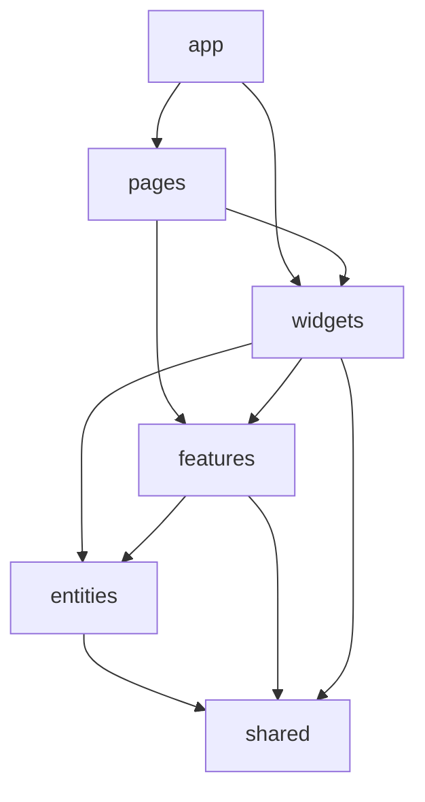

# Case Study: Enforceable Feature-Sliced Design

## Problem

Large React dashboards tend to lose architectural boundaries gradually. A page imports an internal feature file, one widget imports another widget, features begin to depend on each other, and refactoring becomes risky because ownership is no longer visible from the dependency graph.

A folder structure alone cannot prevent this drift.

## Decision

The TraceAxios admin application uses Feature-Sliced Design as a machine-checked dependency model:

```text
app -> pages -> widgets -> features -> entities -> shared
```

ESLint classifies source files by architectural element and rejects dependencies that violate the allowed direction.



## Public API rule

Cross-slice imports must pass through the target slice's `index.ts`. Internal files are not part of the architectural contract.

This allows a slice to reorganize its hooks, UI, schemas, and helpers without forcing unrelated consumers to change.

The rule is stronger than a path-alias convention: ESLint understands `app`, `page`, `widget`, `feature`, `entity`, `shared`, bootstrap, and mock elements, then applies an explicit allowlist.

## Same-layer composition

Widget-to-widget, feature-to-feature, and entity-to-entity imports are intentionally disallowed. This does not mean a large screen must live in one file.

The composition choices are:

- keep private subcomponents inside the owning slice;
- extract reusable domain behavior to an entity;
- extract a user action to a feature;
- compose sibling widgets from a page or higher boundary;
- introduce a shared UI primitive only when it is domain-independent.

This distinction prevents a “smaller files at any cost” approach from turning into cyclic business dependencies.

## Route and rendering boundary

Pages remain thin route roots. The router lazy-loads each page and delegates protected-shell behavior to an application-level route handler.

The route handler coordinates:

- authentication state;
- role-to-route policy;
- a role-specific fallback route;
- onboarding completion;
- preservation of the intended location for login recovery.

Domain composition remains below pages, while global navigation decisions remain above them.

## Supporting conventions

- Component prop types live in colocated `.types.ts` files.
- A component can receive its own directory when colocation would otherwise create a flat file cluster.
- Server state belongs to React Query; client-only session and UI state use focused stores or providers.
- Large vendor groups are split into stable Vite chunks for React, queries, forms, Radix, charts, calendars, and icons.

## Trade-offs and next steps

- Strict boundaries add friction when a concept has not yet found the correct layer.
- `index.ts` files require discipline to avoid becoming unrestricted barrel exports.
- Architectural linting validates dependencies, not the business meaning of a slice.
- Very large slices still need internal segmentation and ownership review.

The friction is intentional: an ambiguous dependency becomes an explicit design decision instead of a silent shortcut.

## Engineering signal

This case demonstrates architecture as executable policy, stable module contracts, deliberate composition, and the ability to keep a large React application evolvable as teams and features grow.
