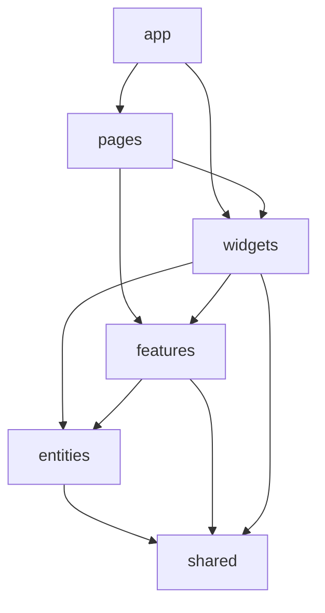

# Кейс: контролируемая Feature-Sliced Design

[English](06-enforceable-fsd.md) | [Русский]

## Проблема

Большие React-дашборды постепенно теряют архитектурные границы: page импортирует внутренний файл feature, widgets зависят друг от друга, features образуют связи между собой, а рефакторинг становится рискованным. Одна структура папок такой дрейф не предотвращает.

## Решение

Admin-приложение TraceAxios использует Feature-Sliced Design как автоматически проверяемую модель зависимостей:

```text
app -> pages -> widgets -> features -> entities -> shared
```

ESLint классифицирует исходные файлы по архитектурным элементам и отклоняет запрещённые направления зависимостей.



## Правило публичного API

Межслайсовые импорты проходят через `index.ts` целевого slice. Внутренние файлы не входят в архитектурный контракт, поэтому slice может реорганизовать hooks, UI, schemas и helpers без изменений у потребителей.

Правило сильнее соглашения о path alias: ESLint различает app, page, widget, feature, entity, shared, bootstrap и mock, затем применяет явный allowlist.

## Композиция на одном слое

Импорты widget-to-widget, feature-to-feature и entity-to-entity запрещены намеренно. Для декомпозиции доступны другие варианты:

- держать приватные subcomponents внутри owning slice;
- вынести переиспользуемое доменное поведение в entity;
- вынести действие пользователя в feature;
- собирать соседние widgets на уровне page или выше;
- создавать shared UI primitive только без доменной зависимости.

Так стремление к маленьким файлам не превращается в циклические бизнес-зависимости.

## Граница маршрутизации и рендеринга

Pages остаются тонкими route roots. Router лениво загружает страницы и передаёт protected-shell поведение application-level handler, который координирует authentication state, role-to-route policy, fallback по роли, завершённость onboarding и сохранение исходного URL для восстановления входа.

Доменная композиция остаётся ниже pages, глобальные решения навигации — выше.

## Поддерживающие соглашения

- Props компонентов лежат в соседних `.types.ts`.
- Компонент получает собственную директорию, если иначе возникает плоский кластер файлов.
- Server state принадлежит React Query; локальная session/UI state — узким stores или providers.
- Крупные vendor groups разделены на стабильные Vite chunks.

## Компромиссы и следующие шаги

- Строгие границы создают трение, пока концепция не нашла правильный слой.
- `index.ts` требуют дисциплины, чтобы не стать бесконтрольными barrel exports.
- Lint проверяет зависимости, но не бизнес-смысл slice.
- Крупным slices всё равно нужны внутренняя сегментация и ownership review.

Трение намеренно: неоднозначная зависимость становится явным архитектурным решением, а не скрытым shortcut.

## Инженерный результат

Кейс демонстрирует архитектуру как исполняемую политику, стабильные module contracts, осознанную композицию и сохранение эволюционности большого React-приложения.
