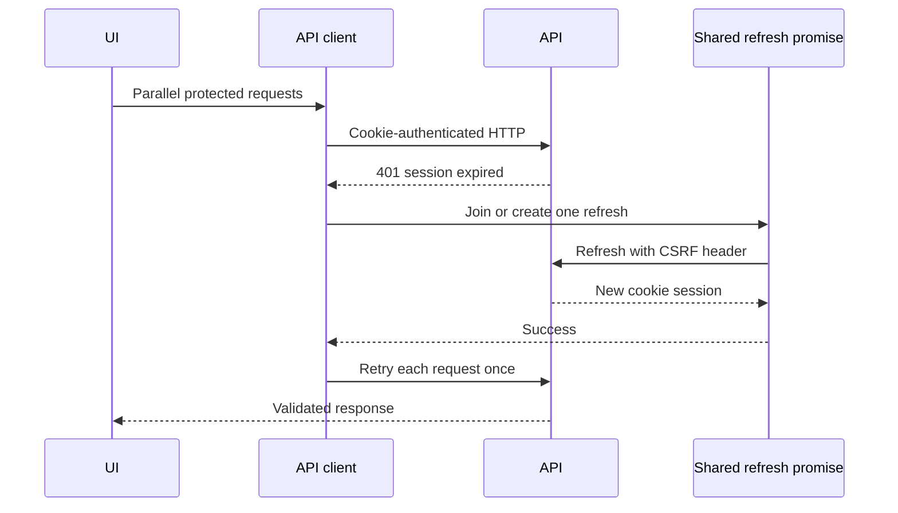

# Case Study: Resilient Client Data Boundary

[English] | [Русский](07-resilient-client-data-boundary.ru.md)

## Problem

An authenticated dashboard can issue many parallel requests. When an access session expires, every request may fail at once. If each failure starts its own refresh, the application creates a refresh storm, races token rotation, repeats mutations, and may redirect several times.

The browser also needs protection against backend contract drift and unsafe storage of authentication credentials.

## Decision

TraceAxios centralizes transport, authentication recovery, and runtime contract validation in one API boundary.

## Cookie-first session handling

- API requests use credentials-enabled cookies.
- Access and refresh tokens are not persisted in local storage.
- Legacy token keys are actively removed.
- The browser stores only a non-sensitive user snapshot used to initialize UI state.
- Unsafe requests receive the CSRF value from a cookie in an explicit header.

Frontend state treats the cookie as opaque. The backend remains the authorization boundary.

## Single-flight refresh

The response interceptor keeps one shared refresh promise. Concurrent 401 responses await the same refresh operation instead of creating one request per failure.

After a successful refresh, each original request is retried once with merged headers. A per-request retry marker prevents loops. If refresh fails, authentication state is cleared and navigation to login is deduplicated while preserving the requested URL.

An explicit invalid-token error bypasses refresh and clears the session immediately.

## Runtime API contracts

Request DTOs and response payloads are validated with Zod at the transport boundary. The client supports:

- individual response models;
- dictionary values validated one by one;
- flattened dictionary responses;
- request validation before network dispatch.

Generated TypeScript types protect compilation; runtime schemas protect the running application when the server returns an unexpected shape.

## Query-scope isolation

React Query keys include organization, project, user, comparison, and report scopes where needed. Bulk hooks normalize identifier order and disable requests with missing scope identifiers.

This avoids two subtle classes of bugs:

- data from one project appearing in another project's view;
- equivalent ID sets creating duplicate cache entries because their input order changed.

## Trade-offs and next steps

- A locally stored user snapshot can be stale and must never be trusted for backend authorization.
- Retrying a non-idempotent mutation after refresh requires endpoint-level idempotency or careful mutation design.
- Hand-maintained Zod schemas can drift from OpenAPI; generated schemas would reduce duplicate maintenance.
- A global error toast is useful as a fallback, but domain-aware screens still need contextual recovery states.

## Engineering signal

This case demonstrates concurrency-aware session recovery, browser credential hygiene, runtime contract enforcement, cache-key design, and separation between UI authorization hints and server-side security.
