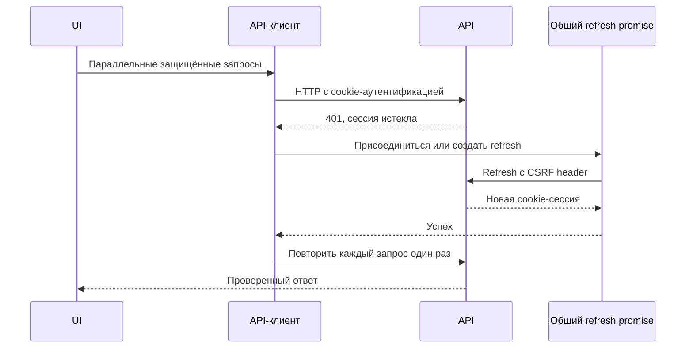

# Кейс: устойчивый клиентский data boundary

[English](07-resilient-client-data-boundary.md) | [Русский]

## Проблема

Авторизованный dashboard отправляет много параллельных запросов. Когда access-сессия истекает, они могут одновременно получить ошибку. Если каждый запускает refresh, возникают refresh storm, гонки ротации токенов, повторы mutations и несколько редиректов.

Браузеру также нужна защита от расхождения backend-контрактов и небезопасного хранения учётных данных.

## Решение

TraceAxios централизует transport, восстановление аутентификации и runtime validation в одной API-границе.

## Cookie-first управление сессией

- API-запросы используют cookies с credentials.
- Access и refresh tokens не сохраняются в local storage.
- Устаревшие token keys удаляются явно.
- В браузере хранится только нечувствительный user snapshot для начального UI state.
- Небезопасные запросы передают CSRF из cookie в отдельном header.

Frontend рассматривает cookie как opaque, а backend остаётся границей авторизации.

## Single-flight refresh

Response interceptor хранит один общий refresh promise. Все параллельные ответы 401 ожидают его вместо отдельных запросов. После успеха исходные запросы повторяются по одному разу с объединёнными headers; marker на запросе предотвращает цикл.

При ошибке refresh authentication state очищается, переход на login дедуплицируется, а исходный URL сохраняется. Явная ошибка invalid-token обходит refresh и немедленно очищает сессию.

## Runtime-контракты API

Request DTO и response payload проверяются Zod на transport boundary. Клиент поддерживает отдельные response models, поэлементную проверку dictionary, flattened dictionary responses и validation запроса до отправки.

TypeScript защищает компиляцию, runtime schemas — работающее приложение при неожиданном ответе сервера.

## Изоляция query scope

React Query keys включают organization, project, user, comparison и report scope. Bulk hooks нормализуют порядок ID и отключают запросы при отсутствующем scope identifier.

Это предотвращает появление данных одного проекта в другом и дублирование cache entries для одинаковых наборов ID в разном порядке.

## Компромиссы и следующие шаги

- Локальный user snapshot может устареть и не используется для backend authorization.
- Повтор неидемпотентной mutation требует endpoint-level idempotency или специального дизайна.
- Ручные Zod schemas могут расходиться с OpenAPI; генерация уменьшит дублирование.
- Global error toast полезен как fallback, но экранам нужны контекстные recovery states.

## Инженерный результат

Кейс показывает concurrency-aware восстановление сессии, безопасное обращение с browser credentials, runtime contracts, проектирование cache keys и разделение UI-подсказок от server-side security.
