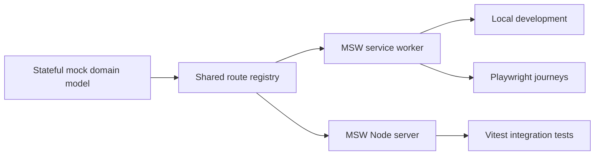

# Case Study: Deterministic Frontend Test Platform

## Problem

A complex admin UI depends on authentication, organizations, projects, integrations, analytics, and failure states. End-to-end tests against a shared backend become slow and flaky, while simplistic one-off mocks hide integration defects and drift away from real workflows.

Code coverage from component tests alone also says little about which production modules are exercised by real browser journeys.

## Decision

TraceAxios maintains one stateful mock API model and adapts it to multiple runtimes:

The same route resolvers, relationships, and payload builders therefore support development, component integration, and browser testing.

## Deterministic state

- Mock data uses a configurable deterministic seed.
- Organizations, teams, projects, members, repositories, invitations, provider connections, and analytics share one relationship-aware state.
- Mutations update the in-memory model, allowing multi-step workflows rather than static fixture responses.
- Configurable delay simulates latency without introducing random timing.
- Integration tests fail on unhandled requests instead of silently reaching a real backend.
- Browser tests can inject one-time failures directly into the active MSW worker.

This supports success, empty, authorization, malformed-data, provider-failure, and session-recovery scenarios without external credentials.

## Independent browser coverage

The E2E pipeline starts an Istanbul-instrumented Vite server. A custom Playwright fixture saves coverage:

- before page unloads;
- at the end of every still-open page;
- into per-event raw JSON files safe for parallel collection.

NYC merges the raw browser coverage and enforces its own 80% statements, branches, functions, and lines thresholds. Vitest coverage has a separate 80% gate.

One broad unit suite therefore cannot hide an unexercised browser workflow, and a large E2E suite cannot hide missing isolated edge cases.

## CI composition

Lint/typecheck, Vitest coverage, and Playwright coverage run as independent reusable jobs. Stage and production Docker images depend on all three gates. Failure artifacts retain reports, traces, screenshots, videos, and processed coverage.

## Trade-offs and next steps

- A mock server can become internally consistent while drifting from the real API.
- OpenAPI-based contract generation and scheduled environment contract tests are the natural drift controls.
- Chromium-only CI provides a focused baseline but not full cross-browser confidence.
- High global E2E coverage can encourage broad navigation tests; meaningful assertions must remain the primary quality signal.
- Seeded data should be versioned alongside business scenarios so changes remain intentional.

## Engineering signal

This case demonstrates test infrastructure as a product: shared contracts, deterministic state, failure injection, multi-layer coverage, and CI gates aligned with deployable artifacts.
