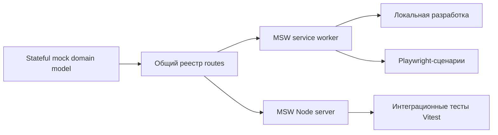

# Кейс: детерминированная платформа frontend-тестирования

[English](08-deterministic-frontend-testing.md) | [Русский]

## Проблема

Сложный admin UI зависит от аутентификации, организаций, проектов, интеграций, аналитики и сценариев ошибок. E2E-тесты с общим backend становятся медленными и нестабильными, а одноразовые примитивные mocks скрывают integration defects и расходятся с реальными workflows.

Coverage только компонентных тестов также не показывает, какие production modules проходят настоящие browser journeys.

## Решение

TraceAxios поддерживает единую stateful mock API model и адаптирует её к разным runtimes:

Одни и те же route resolvers, связи и payload builders используются в разработке, component integration и browser testing.

## Детерминированное состояние

- Mock data использует настраиваемый детерминированный seed.
- Organizations, teams, projects, members, repositories, invitations, provider connections и analytics разделяют связанную модель состояния.
- Mutations обновляют in-memory model и поддерживают многошаговые workflows вместо статических fixtures.
- Настраиваемая задержка имитирует latency без случайного timing.
- Integration tests падают на необработанном запросе, не обращаясь молча к реальному backend.
- Browser tests внедряют одноразовые сбои прямо в активный MSW worker.

Так покрываются success, empty, authorization, malformed-data, provider-failure и session-recovery сценарии без внешних credentials.

## Независимый browser coverage

E2E pipeline запускает Vite server с Istanbul instrumentation. Собственный Playwright fixture сохраняет coverage перед unload, в конце каждого открытого page и в отдельные raw JSON, безопасные для параллельного сбора.

NYC объединяет browser coverage и применяет отдельные пороги 80% для statements, branches, functions и lines. У Vitest есть независимый gate 80%.

Поэтому большой unit suite не скрывает непроверенный browser workflow, а E2E suite — отсутствие изолированных edge cases.

## Композиция CI

Lint/typecheck, Vitest coverage и Playwright coverage работают как независимые reusable jobs. Сборки stage и production images зависят от всех трёх gates. При сбое сохраняются reports, traces, screenshots, videos и обработанный coverage.

## Компромиссы и следующие шаги

- Mock server может быть внутренне согласованным, но расходиться с реальным API.
- OpenAPI generation и плановые environment contract tests — естественная защита от drift.
- Chromium-only CI даёт базовую уверенность, но не полное cross-browser покрытие.
- Высокий E2E coverage может поощрять поверхностные navigation tests; содержательные assertions остаются главным сигналом качества.
- Seeded data следует версионировать вместе с бизнес-сценариями.

## Инженерный результат

Кейс показывает test infrastructure как продукт: общие контракты, детерминированное состояние, fault injection, многоуровневый coverage и CI gates, связанные с deployable artifacts.
