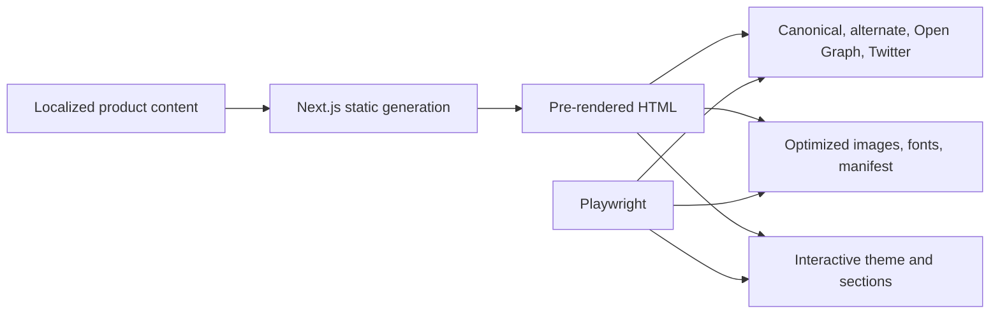

# Case Study: SEO-First Product Surface

[English] | [Русский](09-seo-first-landing.ru.md)

## Problem

A product landing page must serve two audiences simultaneously: people evaluating the product and crawlers building search and social previews. It also needs fast first paint, responsive visuals, theme support, legal routes, security headers, and confidence that metadata and assets remain valid after design changes.

## Decision

The TraceAxios landing uses Next.js static generation for public content, with a typed SEO component and browser tests that treat metadata and public assets as executable contracts.

## Search and social contract

Each public page can declare title, description, social image, and canonical URL. The shared SEO boundary emits:

- index/follow directives;
- canonical URLs;
- locale-specific alternate links and `x-default`;
- Open Graph title, description, URL, locale, type, and image;
- Twitter card metadata;
- product-specific search keywords;
- manifest, favicons, Apple touch icon, and light/dark theme colors.

A sitemap and robots file are generated after production builds.

Playwright verifies the rendered title, description, Open Graph fields, Twitter card, keywords, manifest contents, icons, legal navigation, and that roadmap images load with accessible names.

## Rendering and hydration boundary

The application separates universal, server, and browser bootstrapping. Shared providers compose internationalization, state, and design-system context, while browser-only diagnostics and runtime utilities are mounted only after hydration.

The home page is statically generated with its translation namespaces. A theme- and viewport-dependent visual section is loaded client-side to avoid server/client image mismatches.

## Theme-aware responsive presentation

- Light and dark palettes are defined as design tokens.
- The initial color mode is installed in the document before application content.
- Responsive theme assets are selected using a shared screen context.
- Product previews use optimized Next.js images with explicit aspect ratio and responsive `sizes`.
- Reusable section primitives and Storybook stories keep visual composition reviewable.

## Delivery and security

- Static fonts and assets receive explicit cache policies.
- The server removes the framework identification header.
- Content Security Policy, frame, content-type, referrer, and DNS-prefetch headers are configured centrally.
- Optional Sentry integration and a Web Vitals collection boundary provide observability extension points.
- Lint, typecheck, Jest, and Playwright must succeed before stage or production container builds.

## Trade-offs identified during review

- The client-only themed section is safe from hydration mismatch but reduces pre-rendered content and can introduce layout movement. CSS media queries or an SSR-safe `<picture>` strategy would improve it.
- The CSP still permits inline scripts and styles. Nonces or hashes plus modern reporting would strengthen it.
- Web Vitals are collected but the analytics delivery call is not yet connected.
- The Pages Router and multi-bootstrap template provide flexibility but add complexity for a mostly static site; a modern App Router/static-content pass could reduce client JavaScript.
- Theme selection currently listens to window resize events; media-query subscriptions and responsive image markup would reduce JavaScript work.

## Engineering signal

This case demonstrates SEO as tested behavior, awareness of server/browser rendering differences, theme-aware responsive delivery, security-header ownership, and the ability to identify where a mature template should be simplified for the actual product.
