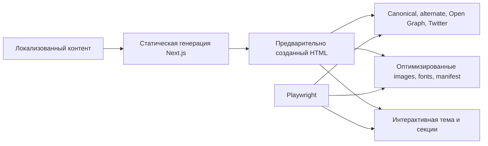

# Кейс: SEO-first продуктовая поверхность

[English](09-seo-first-landing.md) | [Русский]

## Проблема

Landing page одновременно обслуживает людей, оценивающих продукт, и crawlers, формирующих поисковую выдачу и social previews. Нужны быстрый first paint, responsive visuals, темы, legal routes, security headers и уверенность, что metadata и assets остаются валидными после изменений дизайна.

## Решение

Landing TraceAxios использует static generation Next.js для публичного контента, typed SEO component и browser tests, которые рассматривают metadata и public assets как исполняемые контракты.

## Контракт поиска и социальных сетей

Каждая публичная страница задаёт title, description, social image и canonical URL. Общая SEO-граница формирует:

- директивы index/follow;
- canonical URL;
- locale-specific alternate links и `x-default`;
- Open Graph title, description, URL, locale, type и image;
- Twitter card metadata;
- product-specific search keywords;
- manifest, favicons, Apple touch icon и цвета темы light/dark.

После production build генерируются sitemap и robots file. Playwright проверяет rendered title, description, Open Graph, Twitter card, keywords, manifest, icons, legal navigation и загрузку roadmap images с accessible names.

## Граница rendering и hydration

Приложение разделяет universal, server и browser bootstrap. Общие providers собирают i18n, state и design-system context, а browser-only diagnostics и runtime utilities подключаются после hydration.

Главная страница статически генерируется с translation namespaces. Секция, зависящая от темы и viewport, загружается на клиенте, чтобы избежать server/client image mismatch.

## Адаптивное представление с учётом темы

- Light и dark palettes определены как design tokens.
- Начальный color mode устанавливается в document до контента приложения.
- Responsive theme assets выбираются через общий screen context.
- Product previews используют оптимизированные Next.js images с явным aspect ratio и responsive `sizes`.
- Переиспользуемые section primitives и Storybook stories делают визуальную композицию проверяемой.

## Доставка и безопасность

- Для статических fonts и assets заданы cache policies.
- Framework identification header удалён.
- CSP, frame, content-type, referrer и DNS-prefetch headers настроены централизованно.
- Опциональный Sentry и Web Vitals boundary дают точки расширения наблюдаемости.
- До сборки stage/production containers должны пройти lint, typecheck, Jest и Playwright.

## Компромиссы и следующие шаги

- Client-only themed section исключает hydration mismatch, но уменьшает pre-rendered content и может двигать layout; CSS media queries или SSR-safe `<picture>` улучшат решение.
- CSP пока разрешает inline scripts/styles; nonces или hashes и современный reporting усилят защиту.
- Web Vitals собираются, но analytics delivery ещё не подключён.
- Pages Router и multi-bootstrap template сложны для преимущественно статического сайта; App Router/static-content pass может уменьшить client JavaScript.
- Theme selection слушает window resize; media-query subscriptions и responsive markup снизят JavaScript work.

## Инженерный результат

Кейс показывает SEO как тестируемое поведение, понимание различий server/browser rendering, адаптивную theme-aware доставку, владение security headers и способность упрощать зрелый шаблон под реальный продукт.
