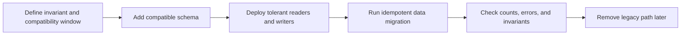

# Case Study: Production Evolution and Migration Discipline

[English](10-production-evolution-and-migrations.md) | [Русский](10-production-evolution-and-migrations.ru.md)

## Problem

TraceAxios evolves across several coupled surfaces: PostgreSQL state, Prisma contracts, NestJS API and worker runtimes, provider integrations, background jobs, and a React admin client. A schema change is therefore not complete when a migration file applies successfully. Old application instances may still be running, queued work may outlive a deployment, and existing rows may need transformation before a new invariant can be enforced.

The maintenance goal is to make change reversible at the release level, observable during rollout, and safe to retry when a deployment or backfill stops halfway.

## Change model

The project treats schema evolution as a sequence rather than a single deployment event:

### 1. Classify the change

Before implementation, a change is classified as additive schema, schema plus data transformation, a new index or uniqueness invariant, an application contract change, a runtime or transport migration, or destructive cleanup. The classification determines deployment order and whether the release needs a separate backfill or compatibility period.

### 2. Expand before contracting

New columns, tables, and indexes are introduced before old fields are removed. Application code is deployed with readers that tolerate both states and writers that populate the new representation. Destructive cleanup belongs to a later release after the new path has been observed in use.

This is especially important for API and worker separation: an API instance and a queue consumer may not restart at exactly the same time.

### 3. Separate schema migration from data migration

Prisma migrations own deterministic database structure. Potentially long-running transformations remain explicit scripts with their own logging and retry behavior. This avoids hiding network calls or unbounded row processing inside a deployment transaction.

One implemented example migrated stored provider credentials to encrypted values. The backfill:

- recognizes records that are already encrypted;
- transforms only rows that still use the legacy representation;
- can be rerun after partial completion;
- reports totals for updated, unchanged, and previously migrated records;
- does not print credential values.

Idempotency turns the backfill from a one-shot operational gamble into a recoverable maintenance operation.

## Migration validation in CI

The migrator workflow starts a clean PostgreSQL 16 service, installs locked dependencies, generates the Prisma client, and applies the complete migration history with the deployment command. Only after that validation does it build the migration image.

This catches broken migration ordering, invalid SQL, and drift between the checked-in schema and generated client before an artifact is published.

## Release and recovery rules

| Situation | Preferred response |
| --- | --- |
| Additive migration fails before completion | Stop the rollout, fix forward, and rerun in a controlled environment. |
| Backfill stops halfway | Correct the cause and rerun the idempotent script; verify its counters. |
| New application code is unhealthy but schema is compatible | Roll back the application image while leaving the additive schema in place. |
| Existing rows violate a new invariant | Keep the constraint unenforced, repair the data, verify, then enable it later. |
| Destructive change causes data loss | Restore from the tested database recovery path; application rollback is insufficient. |

The default database response is forward repair. Down migrations are not treated as a universal rollback mechanism because a reverse schema operation cannot recreate lost or transformed business data.

## Ongoing maintenance

Migration discipline is supported by adjacent practices:

- generated Prisma types keep application code aligned with the schema;
- backend tests cover repositories, services, authentication, providers, schedulers, and workers;
- provider ports contain vendor-specific change;
- health checks and structured logs expose dependency failures;
- generated API contracts reduce accidental frontend/backend drift;
- background work is designed for retry and idempotent persistence.

## Evidence snapshot

At the time of this case-study review, the private backend contained:

- 32 ordered SQL migration files;
- explicit scripts for data backfills;
- a clean-database migration check in GitHub Actions;
- 64 backend test files with an enforced global 80% coverage threshold;
- separate API, scheduler, and worker execution boundaries.

These counts are a review snapshot, not a fixed product promise. The public repository intentionally omits migration SQL, table names, production connection details, and customer data.

## Limitations and next hardening

- A successful clean-database migration does not prove production-duration or locking behavior on a large populated database.
- High-volume index and constraint changes still require query-plan and lock-time measurement.
- The workflow validates the forward path; disaster recovery must also be exercised against backups.
- Record-by-record backfills should move to bounded batches with checkpoints when data volume justifies it.
- Compatibility windows need explicit owners so temporary dual-read or dual-write paths do not become permanent.

## Engineering signal

Database evolution is part of application architecture. The important unit is not a migration file but a compatible rollout: expand, deploy, backfill, verify, and contract with observable recovery points.
