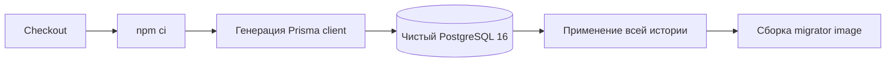

# Кейс: эволюция production-системы и дисциплина миграций

[English](10-production-evolution-and-migrations.md) | [Русский](10-production-evolution-and-migrations.ru.md)

## Проблема

TraceAxios развивается сразу в нескольких связанных слоях: PostgreSQL, Prisma-контракты, API и worker-процессы NestJS, интеграции с провайдерами, фоновые задания и React admin. Поэтому изменение схемы не заканчивается успешным применением одного migration-файла. Во время rollout могут продолжать работать старые экземпляры приложения, задания в очереди могут пережить деплой, а существующие данные иногда требуется преобразовать до включения нового ограничения.

Цель процесса — сделать изменения совместимыми на уровне релиза, наблюдаемыми во время rollout и безопасными для повторного запуска после частичного сбоя.

## Модель изменения

Эволюция схемы рассматривается как последовательность:

### 1. Классификация изменения

До реализации изменение классифицируется как additive schema, schema plus data transformation, новый индекс или uniqueness-инвариант, изменение application-контракта, миграция runtime или транспорта либо destructive cleanup. От категории зависит порядок деплоя и необходимость отдельного backfill или периода совместимости.

### 2. Expand перед contract

Новые колонки, таблицы и индексы добавляются до удаления старых полей. Сначала разворачивается код, который умеет читать оба состояния и записывать новое представление. Destructive cleanup выполняется отдельным более поздним релизом после наблюдения за новым путём.

Это особенно важно при разделении API и workers: HTTP-процесс и consumer очереди могут перезапуститься не одновременно.

### 3. Разделение schema migration и data migration

Prisma migrations отвечают за детерминированную структуру базы. Потенциально долгие преобразования остаются явными скриптами со своим логированием и retry-поведением. Это не позволяет спрятать сетевые вызовы или неограниченную обработку строк внутри deployment-транзакции.

Один из реализованных примеров переводил сохранённые credentials провайдеров в зашифрованное представление. Backfill:

- распознаёт уже зашифрованные записи;
- преобразует только legacy-значения;
- допускает повторный запуск после частичного выполнения;
- выводит количество обновлённых, неизменённых и ранее обработанных записей;
- не пишет сами credentials в логи.

Идемпотентность превращает backfill из одноразовой рискованной операции в восстанавливаемую процедуру сопровождения.

## Проверка миграций в CI

Migrator workflow запускает чистый PostgreSQL 16, устанавливает зависимости из lockfile, генерирует Prisma client и применяет полную историю deployment-командой. Только после успешной проверки собирается migration image.

Так до публикации артефакта обнаруживаются ошибки порядка миграций, некорректный SQL и рассинхронизация schema/client.

## Правила релиза и восстановления

| Ситуация | Предпочтительная реакция |
| --- | --- |
| Additive migration остановилась | Остановить rollout, исправить вперёд и повторить в контролируемом окружении. |
| Backfill выполнился частично | Устранить причину, повторно запустить идемпотентный скрипт и проверить счётчики. |
| Новый application image нестабилен, но схема совместима | Откатить image, сохранив additive schema. |
| Старые строки нарушают новый инвариант | Не включать constraint, исправить данные, проверить и активировать его позже. |
| Destructive change потерял данные | Восстановиться из проверенного backup; отката приложения недостаточно. |

Основная стратегия для базы — fix forward. Down migrations не считаются универсальным rollback-механизмом: обратное изменение схемы не восстановит потерянные или преобразованные бизнес-данные.

## Текущее сопровождение

- Сгенерированные Prisma types синхронизируют код и schema.
- Backend tests покрывают repositories, services, authentication, providers, schedulers и workers.
- Provider ports локализуют vendor-specific изменения.
- Health checks и structured logs показывают сбои зависимостей.
- Генерируемые API-контракты снижают frontend/backend drift.
- Фоновые операции проектируются с retry и идемпотентной записью.

## Срез доказательств

На момент подготовки кейса в приватном backend присутствовали:

- 32 последовательных SQL migration-файла;
- отдельные data-backfill scripts;
- проверка полной истории на чистой базе в GitHub Actions;
- 64 backend test-файла с глобальным coverage threshold 80%;
- раздельные API, scheduler и worker boundaries.

Это срез на дату review, а не неизменное обещание продукта. Публичный репозиторий намеренно не раскрывает SQL миграций, названия таблиц, production connection details и клиентские данные.

## Ограничения и дальнейшее усиление

- Успешное применение к чистой базе не доказывает длительность и locking behavior на большой production-базе.
- Изменения индексов и constraints требуют измерения query plans и lock time.
- Workflow проверяет forward path; disaster recovery также нужно регулярно проверять на backups.
- Record-by-record backfills при росте данных следует переводить на bounded batches с checkpoints.
- У временных dual-read/dual-write путей должны быть владельцы и срок удаления.

## Инженерный сигнал

Эволюция базы — часть архитектуры приложения. Единицей изменения является не migration-файл, а совместимый rollout: expand, deploy, backfill, verify и contract с наблюдаемыми точками восстановления.
