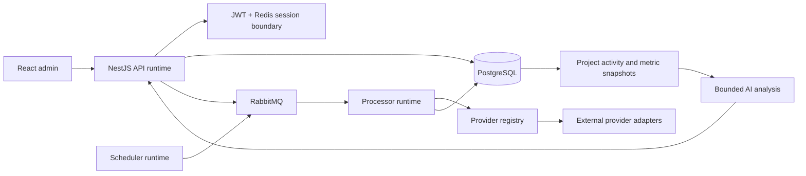

# Backend Architecture Case Studies

These case studies are based on a focused review of the private TraceAxios backend. Their purpose is to make architectural reasoning reviewable while keeping product source and commercially sensitive implementation details private.

## System map

## Deep dives

1. [Split API and worker runtimes](01-split-api-worker-runtime.md)
2. [Multi-provider ingestion and project read models](02-provider-ingestion-and-read-models.md)
3. [Revocable authentication and one-time flows](03-revocable-authentication.md)
4. [Hierarchical multi-tenant authorization](04-multi-tenant-authorization.md)
5. [Bounded AI analysis](05-bounded-ai-analysis.md)

## What was intentionally not published

- source files from the production repositories;
- database definitions and migration history;
- provider credentials, OAuth configuration, and callback details;
- exact queue topology and deployment configuration;
- proprietary metrics, risk scoring, and prompt content;
- customer or production data.

Each case study distinguishes the implemented design from future hardening opportunities. That distinction matters: a portfolio should demonstrate engineering judgment, not pretend that every trade-off has already disappeared.
