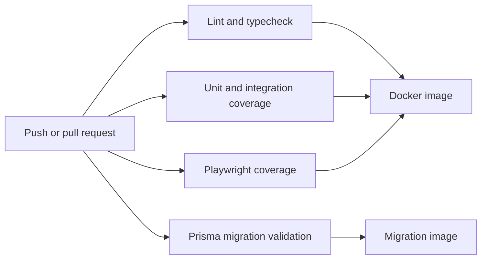

# Testing and Delivery Strategy

## Test pyramid by responsibility

| Layer | Tools | Responsibility |
| --- | --- | --- |
| Backend unit and service | Jest | Business rules, authorization, orchestration, normalization, errors. |
| Backend boundary | Jest, Nest testing utilities, Supertest | Controllers, guards, DTO mapping, selected HTTP slices. |
| Persistence contracts | Jest with Prisma-shaped doubles | Query construction, mapping, upsert behavior, null handling. |
| Worker and queue | Jest, fake timers, transport doubles | Publishing, consumption, retries, acknowledgements, job states. |
| Frontend unit and integration | Vitest, Testing Library, MSW | Components, stores, React Query flows, forms, errors, caching. |
| Browser journeys | Playwright, deterministic MSW handlers | Authentication, onboarding, navigation, workflows, recovery. |
| Database compatibility | PostgreSQL service in CI | Apply every Prisma migration to an empty database. |

## Quality gates

The production repositories enforce 80% minimums for statements, branches, functions, and lines. Frontend unit/integration coverage and browser coverage are independent gates; success in one cannot compensate for gaps in the other.

External APIs, RabbitMQ, Redis, email, and AI providers are mocked at stable boundaries for deterministic tests. Network-dependent contract checks belong to an environment-specific suite rather than the default pull-request pipeline.

## Delivery pipeline



Container images are built after their required verification jobs and pushed only for approved non-pull-request events. Failure artifacts include coverage reports, Playwright reports, traces, screenshots, and videos where applicable.

## This repository

The public sample keeps the feedback loop intentionally small:

```bash
npm run typecheck
npm test
npm run test:coverage
```

Its tests exercise observable application behavior through in-memory ports. They do not assert private method structure and do not access a network, message broker, or database.
